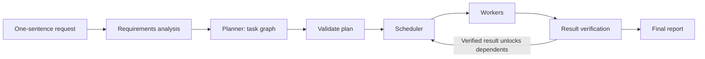

# One-Line Agent

一句话提出软件开发需求，智能体分析目标、拆解任务、分发执行，并汇报结果。

**Status: early development.** This document describes the proposed implementation, not completed features. The plan is to open-source the project and use Devin Bots to help build and test it.

## What it does

Give the agent a one-sentence software development request and a workspace. It turns the request into a plan with dependencies, dispatches independent tasks in parallel, checks their outputs, and produces a report that distinguishes completed work from anything blocked. If the request lacks essential context, it asks a focused question before it runs workers.

## Planned architecture

| Component | Implementation plan |
| --- | --- |
| Requirements | Record the goal, workspace scope, constraints, and observable success criteria. Ask for clarification if the goal or scope is unclear. |
| Planner | Return structured tasks, each with an ID, dependency IDs, an expected output, a verification step, and an execution limit. |
| Validator | Reject malformed plans, duplicate IDs, unknown dependencies, cycles, and plans over the task limit before starting workers. Allow one repair attempt, then report the problem. |
| Scheduler | Persist job and task state. Run only tasks whose dependencies have passed verification. Dispatch independent tasks up to a concurrency limit, and mark dependents blocked when prerequisites fail. |
| Workers | Start with a fake worker for deterministic tests, then add isolated local workers. Give each worker only the inputs and tools its task needs. Keep publishing, deployments, and destructive changes behind approval. |
| Verification | Check observable evidence such as a changed file or a test result. Retry only eligible failures within fixed limits; otherwise report the failure and stop that branch. |
| Reporting | Report completed, failed, and blocked tasks, their evidence, and how much of the run budget was used. |

## Scheduler and limits

The proposed MVP is a command-line tool with an SQLite state store. Keep the scheduler deterministic and separate from the model: the model proposes tasks; the scheduler decides what can run. Use the run ID and task ID as a dispatch key to avoid duplicate active work. Persist attempts before dispatch, expire stalled attempts, and reconcile uncertain results before retrying actions that could have side effects.

Cap the number of tasks, parallel workers, retries, and replans. Set per-task deadlines and a shared token and time budget for the run. Reserve budget before dispatch so parallel workers cannot each assume the full balance is available. When a limit is reached, stop dispatching, cancel outstanding work where possible, and report partial results rather than looping.

## First end-to-end example

> Add missing tests for this demo API and get CI green.

The planner would first inventory API routes and existing coverage. It would then schedule one test-writing task per uncovered route in parallel, integrate the changes, and run the full suite. Finally, it would report which routes gained coverage and include the test and CI results. Success means every route in the inventory has a test and CI passes; a bounded stop with a clear failure report is not counted as completing the request.

## Implementation milestones

1. Define the task schema and test malformed plans, missing dependencies, and cycles.
2. Build the persistent scheduler and fake workers. Test dependency order, parallel dispatch, crash recovery, and cancellation.
3. Add isolated workspace workers and evidence-based verification. Test duplicate dispatch, timeouts, and budget exhaustion.
4. Run the demo API example end to end and publish the results with documented limitations.

## Credits and license

Thanks to [Poke](https://poke.com) for the feedback on the project plan. I plan to use [Devin](https://devin.ai) for implementation and testing. The open-source license has not yet been selected.
